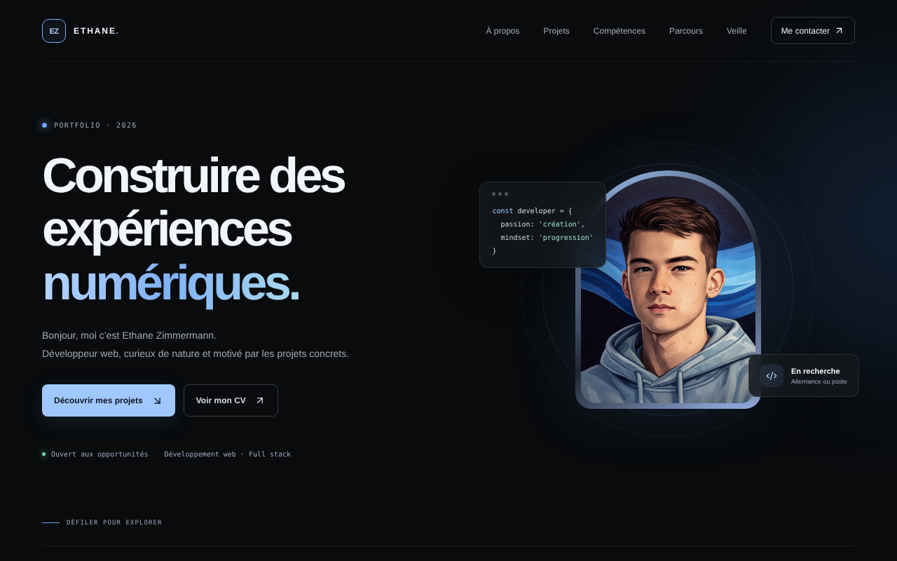

<!-- 🌊 BANNIÈRE -->

  

<!-- ⌨️ TEXTE ANIMÉ -->

  

<!-- 🔗 BOUTONS -->

  
  
  
  

---

## 👋 Hey, je suis Ethane

Développeur web, titulaire d'un **BTS SIO — option SLAM**, à la **recherche d'une alternance**.
Plutôt qu'une passion pour toute l'actualité tech, ce qui m'intéresse vraiment, c'est de **comprendre ce que je code**, d'apprendre **à mon rythme** et de **construire des solutions claires, efficaces et bien structurées**.
Ma force : la rigueur, l'envie d'apprendre et un travail soigné, même sur des projets modestes.

## 🧠 À propos de moi

- 💻 J'apprécie les projets bien organisés, lisibles et documentés
- ⚙️ Je monte en compétence sur le développement web, Java, PHP, Shell et les environnements Linux
- 📚 J'accorde de l'importance à la qualité du code, à la lisibilité et à l'automatisation
- 🚀 Mon objectif : devenir un développeur full-stack fiable et rigoureux

## 🌐 Mon portfolio

  
   
  👆 Clique pour visiter le portfolio : projets, parcours, veille technologique et contact.

## 🛠️ Stack & outils

  

<table align="center">
  <tr>
    <th>Catégorie</th>
    <th>Technologies / Outils</th>
  </tr>
  <tr>
    <td>💻 <strong>Langages</strong></td>
    <td>HTML/CSS · JavaScript · TypeScript · PHP · Java · Python · C# · C · Shell</td>
  </tr>
  <tr>
    <td>🗄️ <strong>Bases de données</strong></td>
    <td>MySQL · PostgreSQL · MariaDB</td>
  </tr>
  <tr>
    <td>⚙️ <strong>Outils & environnements</strong></td>
    <td>Git · GitHub · Linux · Docker · VS Code · XAMPP · WampServer · phpMyAdmin</td>
  </tr>
  <tr>
    <td>🧩 <strong>Concepts</strong></td>
    <td>Automatisation · Scripts · Pipelines · Gestion de version</td>
  </tr>
  <tr>
    <td>🗂️ <strong>Qualités</strong></td>
    <td>Documentation claire · Code lisible · Organisation structurée</td>
  </tr>
</table>

## 🏅 Certification

  <a href="https://www.credly.com/badges/9022a401-279b-4a45-af08-542e24ebebd0">Voir mon badge Credly ↗</a>

## 😄 Une blague de dev

  

---

  📫 Une idée, une alternance, une question ? <a href="mailto:ethan.zim@hotmail.com">ethan.zim@hotmail.com</a>

<!-- ⚙️ FOOTER -->

  

